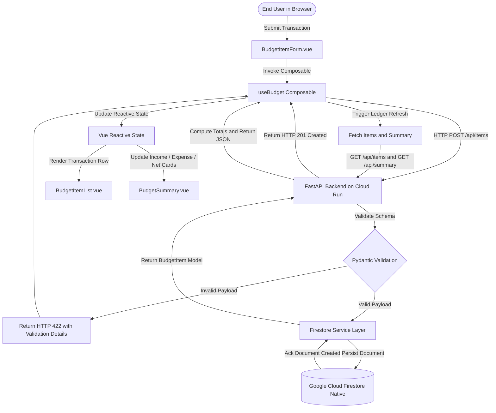
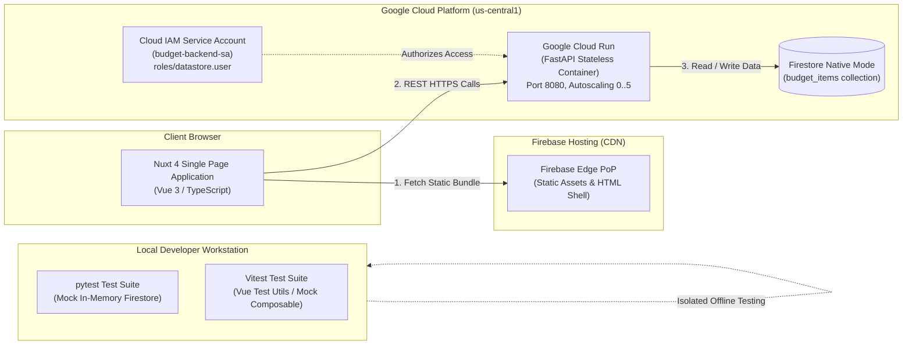
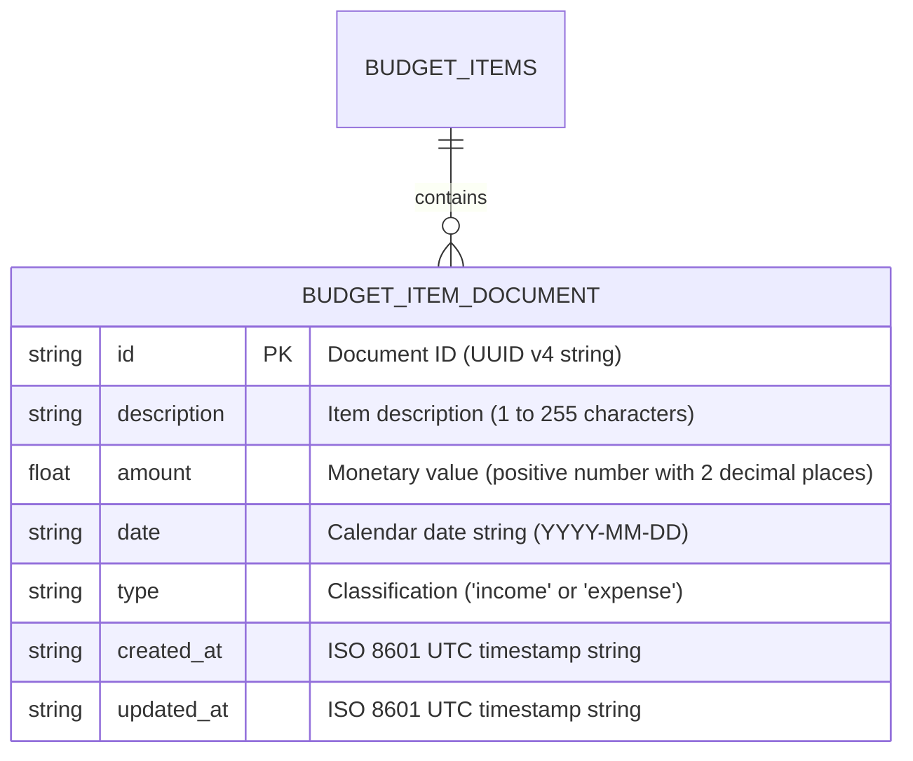
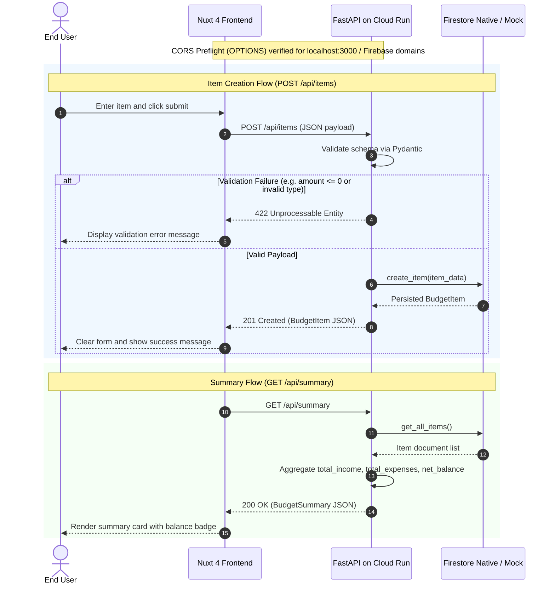
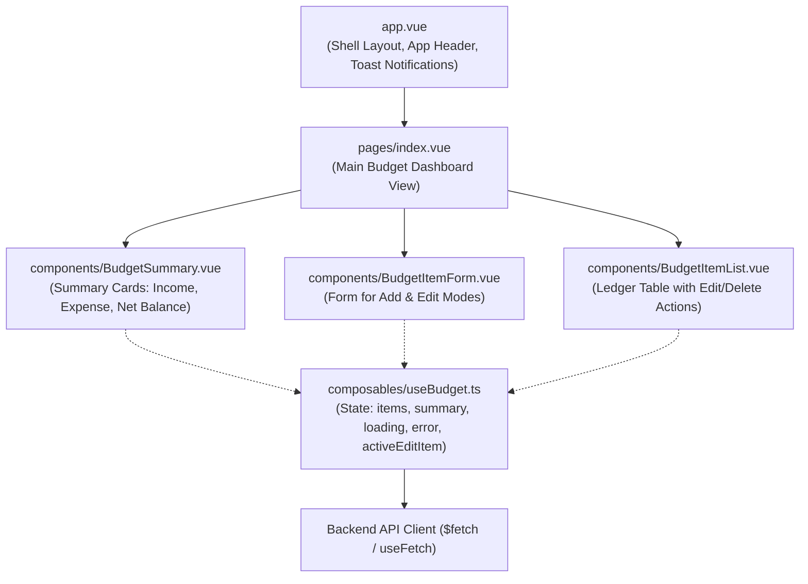

# spec-budget-app

## Metadata

| Field | Value |
|---|---|
| **Feature** | Budget Tracking Application Specification |
| **Parent feature** | None |
| **Sub-features** | None |
| **Requirement refs** | BR-001, BR-002, BR-003, BR-004, UR-001, UR-002, UR-003, UR-004, UR-005, UR-006, UR-007, FR-001, FR-002, FR-003, FR-004, FR-005, FR-006, FR-007, FR-008, FR-009, FR-010, FR-011, FR-012, NFR-001, NFR-002, NFR-003, NFR-004, NFR-005, NFR-006, NFR-007, NFR-008, NFR-009, NFR-010, NFR-011, NFR-012, NFR-013 |
| **Feature type** | Architecture |
| **Status** | Draft |

## Description

This specification defines the complete technical architecture, API contracts, persistence model, frontend structure, containerization, deployment automation, and testing strategy for the Budget Tracking Application. The application delivers personal cash-flow ledger recording, real-time balance aggregation, and full lifecycle transaction management. The system executes as a serverless topology combining a FastAPI service on Google Cloud Run, a Nuxt 4 web application on Firebase Hosting, and Google Cloud Firestore in Native mode, supplemented by an offline mock persistence architecture enabling local testing with zero cloud credentials.

## Components

| Component | Responsibility | Owns data | Technology |
|---|---|---|---|
| **Web Frontend** | Provides responsive user interface for transaction recording, ledger browsing, editing, item deletion, and summary card rendering. | Ephemeral client state (`items`, `summary`, `loading`, `error`, `activeEditItem`). | Nuxt 4, Vue 3, TypeScript, Vite, Tailwind CSS / Vanilla CSS. |
| **Backend REST API** | Validates incoming payloads, executes CRUD operations, calculates summary totals, and enforces HTTP response contracts. | Transaction schemas, validation rules, CORS headers. | Python 3.12, FastAPI, Pydantic v2, Uvicorn. |
| **Firestore Service Layer** | Interfaces with Firestore Native mode or in-memory repository depending on configuration. | Abstract document translation and query orchestration. | Google Cloud Firestore Python SDK (`google-cloud-firestore`), In-Memory Mock. |
| **Database Engine** | Persists budget transactions with document-level indexing and acid collection semantics. | Persistent `budget_items` documents. | Google Cloud Firestore (Native mode). |
| **Automation Scripts** | Provisions cloud infrastructure, configures IAM roles, builds container images, and deploys services. | Project ID, region parameters, deployment environment variables. | Bash shell, Google Cloud CLI (`gcloud`), Firebase CLI (`firebase-tools`). |
| **Test Suites** | Validates backend route contracts, business calculation logic, and frontend components in total isolation without cloud credentials. | Mock test fixtures and assertion states. | Pytest, HTTPX, Vitest, Vue Test Utils. |

## Component boundaries

| Boundary | What crosses it | Protocol | Auth |
|---|---|---|---|
| Web Frontend → Backend REST API | JSON transaction payloads, query requests, summary requests. | HTTPS / REST | Anonymous in v1.0 (single-user model per BR-002, UR-001..005). Preflight CORS validated. |
| Backend REST API → Firestore Native | Document write/read requests, collection iteration streams. | gRPC / Google APIs over TLS | Google Cloud IAM service account (`budget-backend-sa`) with `roles/datastore.user`. |
| Local Backend Tests → In-Memory Store | Direct in-process data calls to dictionary-backed repository. | Python direct invocation | None (local execution mode, zero cloud credentials). |
| Automation Scripts → Google Cloud Platform | Resource provisioning, IAM bindings, container build submissions, Cloud Run service deployments. | HTTPS / gcloud API CLI calls | Operator workstation credentials (`gcloud auth login`). |
| Automation Scripts → Firebase Hosting | Production web static asset bundles and routing configurations. | HTTPS / Firebase CLI calls | Operator Firebase credentials (`firebase login`). |

## Data flow



**Note:** PNG rendering requires mermaid-cli. To generate:

```bash
npm install -g @mermaid-js/mermaid-cli
mmdc -i diagram.mmd -o diagram.png
```

Or use [Mermaid Live Editor](https://mermaid.live) to render online.

### Requirement: Budget item creation and ledger synchronization

The system SHALL accept transaction inputs from the client, validate fields against data integrity policies, persist the record in Firestore Native mode, and return the persisted item with HTTP status 201 Created [FR-001, FR-007, NFR-001, NFR-003].

#### Scenario: Successful item creation and state update
- **GIVEN** the backend API is operational and Firestore Native is connected
- **WHEN** the user submits a valid transaction with description "Freelance Invoice", amount 1250.00, date "2026-10-13", and type "income"
- **THEN** the backend SHALL create a document in `budget_items` with a generated UUID identifier, timestamps, and input values
- **AND** the backend SHALL return HTTP status 201 with the created object JSON
- **AND** the frontend SHALL add the transaction to the ledger list and trigger a summary recalculation

#### Scenario: Rejection of invalid item payload
- **GIVEN** the user enters an invalid monetary amount of -45.00 or an unrecognized type "credit"
- **WHEN** the payload is submitted to `/api/items`
- **THEN** the backend SHALL reject the request with HTTP status 422 Unprocessable Entity
- **AND** the backend SHALL return error details specifying field constraints
- **AND** the system SHALL NOT persist any document to Firestore

#### Scenario: Firestore service write failure and error handling
- **GIVEN** Firestore Native returns a transient deadline exceeded or service unavailable error
- **WHEN** the backend attempts to persist a validated budget item
- **THEN** the backend SHALL catch the storage exception, log the diagnostic details with request context, and return HTTP status 503 Service Unavailable
- **AND** the frontend SHALL display an inline notification alerting the user to retry the operation

### Requirement: Ledger listing and summary calculation

The system SHALL return all budget items ordered chronologically descending by date and provide an aggregated financial summary reflecting total income, total expenses, and net balance [FR-002, FR-006, FR-008, FR-009, NFR-002, NFR-007].

#### Scenario: Successful ledger retrieval and summary computation
- **GIVEN** the database contains recorded transactions comprising income and expense entries
- **WHEN** the frontend requests `GET /api/items` and `GET /api/summary`
- **THEN** the backend SHALL return all items ordered by date descending with HTTP status 200 OK
- **AND** the backend SHALL return `total_income`, `total_expenses`, `net_balance` (`total_income - total_expenses`), and `item_count` with HTTP status 200 OK
- **AND** the frontend SHALL render ledger rows and the summary card within 200 milliseconds p95

#### Scenario: Retrieval on empty collection
- **GIVEN** the database contains zero budget items
- **WHEN** the client requests `GET /api/items` and `GET /api/summary`
- **THEN** `/api/items` SHALL return an empty JSON array `[]` with HTTP status 200 OK
- **AND** `/api/summary` SHALL return `total_income: 0.00`, `total_expenses: 0.00`, `net_balance: 0.00`, and `item_count: 0` with HTTP status 200 OK

### Requirement: Budget item modification and deletion

The system SHALL update existing transactions and purge deleted transactions from Firestore Native mode while keeping client state synchronized [FR-004, FR-005, FR-008].

#### Scenario: Successful item update
- **GIVEN** an existing budget item exists with identifier "item-101"
- **WHEN** the client submits a PUT request to `/api/items/item-101` with updated amount 85.00 and description "Monthly Utilities"
- **THEN** the backend SHALL update the document in Firestore, update `updated_at` to the current timestamp, and return HTTP status 200 OK
- **AND** the frontend SHALL update the table row and refresh the summary card

#### Scenario: Deletion of budget item
- **GIVEN** an existing budget item exists with identifier "item-101"
- **WHEN** the user confirms deletion and the client submits a DELETE request to `/api/items/item-101`
- **THEN** the backend SHALL delete the document from Firestore and return HTTP status 204 No Content
- **AND** the frontend SHALL remove the item from the ledger view and decrement summary metrics

#### Scenario: Mutation on non-existent item identifier
- **GIVEN** no document exists with identifier "item-missing"
- **WHEN** the client submits a PUT or DELETE request for "item-missing"
- **THEN** the backend SHALL return HTTP status 404 Not Found with error detail "Budget item not found"

## Topology



**Note:** PNG rendering requires mermaid-cli. To generate:

```bash
npm install -g @mermaid-js/mermaid-cli
mmdc -i diagram.mmd -o diagram.png
```

Or use [Mermaid Live Editor](https://mermaid.live) to render online.

## Cloud boundaries

All cloud infrastructure resides within Google Cloud Platform and its native Firebase developer tier.

| Component | Cloud / Region | Reason |
|---|---|---|
| **Google Cloud Run** | GCP / `us-central1` | Houses backend FastAPI container. Regional collocation with Firestore minimizes egress latency and scales to 0 instances when idle [BR-002, NFR-004]. |
| **Firestore Native Mode** | GCP / `nam5` (multi-region) or `us-central1` | Serves as system of record for financial documents with automatic high availability and zero maintenance overhead [NFR-001]. |
| **Firebase Hosting** | GCP / Firebase Global CDN Edge | Delivers compiled Nuxt static assets to users globally with SSL termination and edge caching [BR-002, NFR-005]. |
| **Cloud IAM** | GCP / Global | Restricts backend container identity (`budget-backend-sa`) strictly to `roles/datastore.user` [NFR-012]. |
| **Local Environment** | Developer Workstation (Offline) | Executes isolated test runners with zero cloud network egress [BR-003, UR-006, NFR-009, NFR-010]. |

## Failure modes

| Failure | Impact | Detection | Mitigation |
|---|---|---|---|
| **Firestore Native Transient Failure** | Backend cannot read or write budget documents. | Backend catches GoogleAPICallError or Firestore exceptions; Cloud Logging captures error stack trace. | Backend returns HTTP 503 Service Unavailable; frontend displays user retry alert [NFR-007]. |
| **Cloud Run Cold Start Latency** | Initial request after idle period takes up to 1-2 seconds. | Cloud Run request latency telemetry in Cloud Monitoring. | Stateless lightweight container image (`python:3.12-slim`) with minimal dependencies keeps cold start under 1.5 seconds. Frontend displays loading skeletons [NFR-004, NFR-007]. |
| **Network Disconnection in Browser** | Frontend cannot reach backend API endpoints. | `fetch` exception caught by `useBudget` composable. | Frontend surfaces persistent alert banner notifying user of offline condition and preserves form contents [FR-007, FR-008]. |
| **Malformed Client Payload** | Request fails data validation. | Pydantic model validation in FastAPI request pipeline. | Backend returns HTTP 422 with structured field errors; frontend highlights affected inputs [NFR-003]. |
| **Cross-Origin Rejection (CORS)** | Browser blocks API responses if frontend domain is not permitted. | Browser console logs CORS policy violation; OPTIONS preflight fails. | FastAPI `CORSMiddleware` configured with dynamic origins supporting `localhost:3000` and production Firebase Hosting domains [NFR-006]. |

## Non-functional requirements addressed

| NFR | Target | How this architecture achieves it |
|---|---|---|
| **NFR-001: Storage Engine** | 100% of items reside in Firestore Native collection `budget_items`. | Backend Firestore service layer persists all records to `budget_items` collection using `google-cloud-firestore`. |
| **NFR-002: Data Precision** | Zero rounding discrepancies across sum calculations. | Backend models monetary values with fixed 2-decimal arithmetic; summary aggregation rounds results explicitly using standard decimal arithmetic. |
| **NFR-003: Data Validation** | Reject undeclared attributes, length > 255, negative amounts. | Pydantic v2 schema enforces `extra="forbid"`, `max_length=255`, `gt=0`, and ISO date pattern checks. |
| **NFR-004: Backend Hosting** | Stateless container on Cloud Run with min-instances 0. | Container executes on Cloud Run with `--min-instances 0`, enabling true scale-to-zero when idle to eliminate compute billing. |
| **NFR-005: Frontend Hosting** | 100% static asset delivery via Firebase Hosting CDN. | Nuxt 4 configured for static pre-rendering (`npm run generate`); assets deployed to Firebase Hosting global CDN. |
| **NFR-006: CORS Configuration** | Allow Firebase Hosting domains and `http://localhost:3000`. | FastAPI CORS middleware configured with environment-based allowed origin list including local development port and Firebase domains. |
| **NFR-007: API Latency** | p95 latency <= 200 ms for up to 1,000 items (warm container). | Lean async FastAPI route handlers and direct Firestore collection iteration ensure queries return well under 200 ms. |
| **NFR-008: Frontend Load Time** | First Contentful Paint (FCP) <= 1.5 seconds. | Pre-rendered static HTML shell and lightweight Vue 3 bundle distributed via CDN edge nodes. |
| **NFR-009: Offline Backend Testing** | Execution time <= 10s without GCP credentials. | Pytest uses dependency injection to supply `MockFirestoreService` storing data in memory; tests run offline with zero cloud SDK calls. |
| **NFR-010: Offline Frontend Testing** | Execution time <= 15s without network access. | Vitest runs against Vue Test Utils with mocked composable methods; no external network calls are performed. |
| **NFR-011: Test Coverage Threshold** | Statement and branch coverage >= 70%. | Test suites test all CRUD endpoints, summary calculation edge cases, form validation, and component rendering states. |
| **NFR-012: Least Privilege IAM** | Zero administrative roles assigned to backend runtime. | Setup script binds only `roles/datastore.user` to Cloud Run runtime service account `budget-backend-sa`. |
| **NFR-013: Secrets Management** | Zero credentials in git or frontend bundles. | Backend utilizes default Google Cloud IAM workload credentials; zero service account key files or API tokens are generated or committed. |

## Design decisions

| Decision | Options considered | Chosen | Rationale |
|---|---|---|---|
| **Backend Framework** | FastAPI, Flask, Django | FastAPI | Native async support, high performance, automatic OpenAPI documentation, and robust Pydantic v2 validation out of the box. |
| **Frontend Framework** | Nuxt 4 / Vue 3, Next.js / React, SvelteKit | Nuxt 4 / Vue 3 | Lightweight reactive composables, straightforward static pre-rendering, excellent developer ergonomics, and native Vue 3 reactivity. |
| **Database Mode** | Firestore Native Mode, Firestore Datastore Mode, Cloud SQL | Firestore Native Mode | Serverless document store with generous free tier, automatic scale-to-zero pricing, and native Python client support [NFR-001]. |
| **Testing Isolation Strategy** | Firestore Emulator Docker container, Remote GCP test database, In-Memory Repository Mock | In-Memory Repository Mock | Emulator requires Java/Docker runtime and startup latency. Remote database requires credentials and internet. In-memory mock executes in milliseconds offline [BR-003, UR-006, NFR-009]. |
| **Ledger Summary Calculation** | Firestore aggregation queries (`count()`, `sum()`), Client-side calculation, Backend service calculation | Backend service calculation (`GET /api/summary`) | Centralizes monetary rounding rules in Python, avoids distributed float anomalies, and keeps frontend logic presentation-focused [NFR-002]. |

## Sub-feature breakdown

| Sub-feature | Spec section | Description |
|---|---|---|
| **Data Model & Firestore Schema** | Section: Data Model & Firestore Schema | Document schema, types, constraints, and Firestore Native indexing. |
| **RESTful API Specification** | Section: RESTful API Specification | FastAPI endpoints, JSON request/response payloads, validation, and CORS. |
| **Frontend Architecture** | Section: Frontend Architecture | Nuxt 4 page and component hierarchy, `useBudget` composable, UI states. |
| **GCP Automation & Containerization** | Section: GCP Automation & Containerization | Dockerfile, `setup-gcloud.sh`, `deploy-backend.sh`, `deploy-frontend.sh`, `firebase.json`. |
| **Local Testing Strategy** | Section: Local Testing Strategy | Offline pytest suite, mocked repository layer, Vitest frontend tests, coverage commands. |

## Data Model & Firestore Schema



### Collection: `budget_items`

The persistent data store consists of a single root collection named `budget_items` in Firestore Native mode [NFR-001].

#### Document Attributes and Constraints

| Field | Type | Required | Constraints | Description |
|---|---|---|---|---|
| `id` | `string` | Yes | UUID v4 string format (36 chars) | Unique identifier for the transaction record. Matches document key. |
| `description` | `string` | Yes | 1 <= length <= 255, non-empty, stripped of leading/trailing whitespace | Text description of the transaction (e.g., "Monthly Salary", "Grocery Store"). |
| `amount` | `number` (float) | Yes | > 0.00, rounded to 2 decimal places | Absolute monetary quantity of the transaction. Always positive [FR-001]. |
| `date` | `string` | Yes | ISO 8601 calendar date format `YYYY-MM-DD` | Date when the financial event occurred [FR-001]. |
| `type` | `string` | Yes | Enum: `"income"` or `"expense"` | Direction of monetary flow. Determines sign in summary calculations [FR-001, FR-006]. |
| `created_at` | `string` | Yes | ISO 8601 UTC timestamp format `YYYY-MM-DDTHH:MM:SSZ` | System timestamp when record was initially created. |
| `updated_at` | `string` | Yes | ISO 8601 UTC timestamp format `YYYY-MM-DDTHH:MM:SSZ` | System timestamp when record was last updated. |

### Firestore Native Indexing Considerations

1. **Automatic Single-Field Indexing:** Firestore Native mode automatically indexes every document field in both ascending and descending order.
2. **Collection Queries:**
   - Listing items chronologically (`budget_items.order_by("date", direction=DESCENDING)`) is satisfied by Firestore's automatic single-field index on `date`.
   - Listing items by creation order (`budget_items.order_by("created_at", direction=DESCENDING)`) is satisfied by the automatic single-field index on `created_at`.
3. **Composite Index Requirements:**
   - The application does not execute multi-field filtered and ordered queries (e.g., filter by `type == 'income'` while ordering by `date DESC`).
   - Summary computation reads documents from the collection and aggregates values in the service layer.
   - Therefore, no custom composite index entries or `firestore.indexes.json` index definitions are required. Default automatic indexing satisfies all application query requirements.

## RESTful API Specification (FastAPI)



### Global API Conventions
- **Base URL:** `/api`
- **Request and Response Payload Format:** `application/json; charset=utf-8`
- **CORS Policy:** Allowed origins configured via environment variable `CORS_ORIGINS`. Local origin `http://localhost:3000` is permitted by default alongside production Firebase Hosting domains [NFR-006].
- **Error Response Format:**
  ```json
  {
    "detail": "Descriptive error message string or validation error array"
  }
  ```

### Endpoints Overview

| Method | Path | Summary | Success Status | Error Statuses |
|---|---|---|---|---|
| `POST` | `/api/items` | Create a new budget item | 201 Created | 422 Unprocessable Entity, 500/503 Service Error |
| `GET` | `/api/items` | List all budget items ordered by date descending | 200 OK | 500/503 Service Error |
| `GET` | `/api/items/{id}` | Retrieve a single budget item by identifier | 200 OK | 404 Not Found, 500/503 Service Error |
| `PUT` | `/api/items/{id}` | Update an existing budget item by identifier | 200 OK | 404 Not Found, 422 Unprocessable Entity |
| `DELETE` | `/api/items/{id}` | Delete a budget item by identifier | 204 No Content | 404 Not Found, 500/503 Service Error |
| `GET` | `/api/summary` | Compute and return aggregated financial summary | 200 OK | 500/503 Service Error |

---

### Endpoint: `POST /api/items`

Creates a new budget transaction record [FR-001, UR-001].

#### Request Schema (`BudgetItemCreate`)
```json
{
  "$schema": "https://json-schema.org/draft/2020-12/schema",
  "title": "BudgetItemCreate",
  "type": "object",
  "additionalProperties": false,
  "required": ["description", "amount", "date", "type"],
  "properties": {
    "description": {
      "type": "string",
      "minLength": 1,
      "maxLength": 255,
      "description": "Descriptive label for the transaction"
    },
    "amount": {
      "type": "number",
      "exclusiveMinimum": 0.0,
      "description": "Positive monetary quantity with up to 2 decimal places"
    },
    "date": {
      "type": "string",
      "pattern": "^\\d{4}-\\d{2}-\\d{2}$",
      "description": "ISO 8601 calendar date string (YYYY-MM-DD)"
    },
    "type": {
      "type": "string",
      "enum": ["income", "expense"],
      "description": "Transaction category"
    }
  }
}
```

#### Response: `201 Created`
```json
{
  "id": "c3b9b4a1-8d25-4b10-90c7-6e6931fbf523",
  "description": "Freelance Design Work",
  "amount": 1250.00,
  "date": "2026-10-13",
  "type": "income",
  "created_at": "2026-10-13T16:00:00Z",
  "updated_at": "2026-10-13T16:00:00Z"
}
```

#### Response: `422 Unprocessable Entity`
Returned when validation fails (amount <= 0, description empty, date malformed, type not income/expense, or undeclared properties present) [NFR-003].

---

### Endpoint: `GET /api/items`

Retrieves all budget items ordered chronologically descending by `date` [FR-002, UR-002].

#### Query Parameters
None required in v1.0. Returns all items for the user ledger.

#### Response: `200 OK`
```json
[
  {
    "id": "c3b9b4a1-8d25-4b10-90c7-6e6931fbf523",
    "description": "Freelance Design Work",
    "amount": 1250.00,
    "date": "2026-10-13",
    "type": "income",
    "created_at": "2026-10-13T16:00:00Z",
    "updated_at": "2026-10-13T16:00:00Z"
  },
  {
    "id": "a1f8e210-4412-4f3b-b299-1a2b3c4d5e6f",
    "description": "Grocery Shopping",
    "amount": 84.50,
    "date": "2026-10-12",
    "type": "expense",
    "created_at": "2026-10-12T14:30:00Z",
    "updated_at": "2026-10-12T14:30:00Z"
  }
]
```

Returns `[]` when the collection is empty.

---

### Endpoint: `GET /api/items/{id}`

Retrieves a single budget item by its unique identifier [FR-003, UR-002, UR-003].

#### Path Parameters
- `id` (`string`): Unique item identifier.

#### Responses
- **`200 OK`**: Returns the matching `BudgetItem` object.
- **`404 Not Found`**: Returned when the specified identifier does not exist. Payload: `{"detail": "Budget item not found"}`.

---

### Endpoint: `PUT /api/items/{id}`

Updates an existing budget item by its unique identifier [FR-004, UR-003].

#### Path Parameters
- `id` (`string`): Unique item identifier.

#### Request Schema (`BudgetItemUpdate`)
Same validation rules as `BudgetItemCreate`. Requires all 4 transaction attributes (`description`, `amount`, `date`, `type`).

#### Responses
- **`200 OK`**: Returns the updated `BudgetItem` object with refreshed `updated_at` timestamp.
- **`404 Not Found`**: Returned when the specified identifier does not exist.
- **`422 Unprocessable Entity`**: Returned when request payload fails validation.

---

### Endpoint: `DELETE /api/items/{id}`

Deletes an existing budget item permanently from the store [FR-005, UR-004].

#### Path Parameters
- `id` (`string`): Unique item identifier.

#### Responses
- **`204 No Content`**: Document purged successfully. Empty response body.
- **`404 Not Found`**: Returned when the specified identifier does not exist.

---

### Endpoint: `GET /api/summary`

Computes aggregated totals across all stored budget transactions [FR-006, UR-005, NFR-002].

#### Calculation Formula
- `total_income` = sum of `amount` where `type == "income"`, rounded to 2 decimal places (default `0.00`).
- `total_expenses` = sum of `amount` where `type == "expense"`, rounded to 2 decimal places (default `0.00`).
- `net_balance` = `total_income - total_expenses`, rounded to 2 decimal places (default `0.00`).
- `item_count` = total count of items in ledger (default `0`).

#### Response: `200 OK` (`BudgetSummary`)
```json
{
  "total_income": 3500.00,
  "total_expenses": 1420.50,
  "net_balance": 2079.50,
  "item_count": 8
}
```

## Frontend Architecture (Nuxt 4 / Vue 3)



### Component Hierarchy and Responsibilities

| File Path | Component | Responsibility | Props / Emits |
|---|---|---|---|
| `frontend/app.vue` | Root Application Shell | Provides global HTML shell, header navigation bar, application title, and global toast notifications container. | None (root component). |
| `frontend/pages/index.vue` | Dashboard Page | Composes `BudgetSummary`, `BudgetItemForm`, and `BudgetItemList` into a responsive two-column or stacked dashboard layout. Orchestrates initial data fetching on page mount. | None (page component). |
| `frontend/components/BudgetSummary.vue` | Financial Summary Card | Renders three metric cards: Total Income (green indicator), Total Expenses (red indicator), and Net Balance (green if >= 0, red if < 0). Displays item counter badge. | Reads `summary` from `useBudget`. |
| `frontend/components/BudgetItemForm.vue` | Transaction Entry & Edit Form | Handles user inputs for description, amount, date, and type (`income` / `expense`). Executes client-side validation before submission. Supports both "Add Item" and "Edit Item" modes. | Emits: `@saved`, `@cancelled`. Reads `activeEditItem` from `useBudget`. |
| `frontend/components/BudgetItemList.vue` | Ledger Table View | Renders chronological list of budget items with date, description, type badge, and formatted currency amount. Provides "Edit" button and "Delete" button with confirmation prompt. | Emits: `@edit(item)`, `@delete(id)`. Reads `items`, `loading` from `useBudget`. |

### Composable Contract: `composables/useBudget.ts`

The reactive state management and API integration is encapsulated in `useBudget.ts` [FR-007, FR-008, FR-009]:

```typescript
// Conceptual Interface Specification
export interface BudgetItem {
  id: string;
  description: string;
  amount: number;
  date: string;
  type: 'income' | 'expense';
  created_at: string;
  updated_at: string;
}

export interface BudgetItemInput {
  description: string;
  amount: number;
  date: string;
  type: 'income' | 'expense';
}

export interface BudgetSummary {
  total_income: number;
  total_expenses: number;
  net_balance: number;
  item_count: number;
}

export interface UseBudgetReturn {
  // Reactive State
  items: Ref<BudgetItem[]>;
  summary: Ref<BudgetSummary>;
  loading: Ref<boolean>;
  error: Ref<string | null>;
  activeEditItem: Ref<BudgetItem | null>;

  // Methods
  fetchItems: () => Promise<void>;
  fetchSummary: () => Promise<void>;
  fetchAll: () => Promise<void>;
  createItem: (payload: BudgetItemInput) => Promise<boolean>;
  updateItem: (id: string, payload: BudgetItemInput) => Promise<boolean>;
  deleteItem: (id: string) => Promise<boolean>;
  setEditItem: (item: BudgetItem | null) => void;
  clearError: () => void;
}
```

### UI States and User Feedback

1. **Loading State:**
   - On initial mount or when mutations execute, `loading` is set to `true`.
   - The summary card displays skeleton placeholders, and the items table renders a loading indicator.
2. **Error State:**
   - Network errors, 422 validation errors, and 500 server errors set `error` state.
   - An alert banner displays the error message with a dismiss button. Form fields highlight errors inline.
3. **Empty State:**
   - When `items.length === 0` and `loading === false`, `BudgetItemList.vue` displays a friendly empty state message encouraging the user to record their first transaction [UC-002].
4. **Delete Confirmation:**
   - Clicking "Delete" prompts a confirmation dialog (`window.confirm` or accessible modal) before dispatching the DELETE request [UR-004, UC-004].

## GCP Automation & Containerization Specification

```mermaid
flowchart TD
  subgraph SetupScript["scripts/setup-gcloud.sh"]
    S1["Verify gcloud CLI and Active Project"] --> S2["Enable APIs: run, firestore, cloudbuild, artifactregistry"]
    S2 --> S3["Create Firestore Database (Native Mode)"]
    S3 --> S4["Create Artifact Registry Repository: budget-repo"]
    S4 --> S5["Create Service Account: budget-backend-sa"]
    S5 --> S6["Assign IAM Role: roles/datastore.user"]
  end

  subgraph BackendDeploy["scripts/deploy-backend.sh"]
    B1["Build Container via Cloud Build"] --> B2["Submit to Artifact Registry (budget-repo)"]
    B2 --> B3["Deploy to Cloud Run (Stateless, Port 8080, min-instances 0)"]
    B3 --> B4["Echo Deployed Backend Service URL"]
  end

  subgraph FrontendDeploy["scripts/deploy-frontend.sh"]
    F1["Run npm --prefix frontend run generate from repo root"] --> F2["Generate Static Assets in .output/public"]
    F2 --> F3["Deploy to Firebase Hosting via firebase deploy"]
    F3 --> F4["Echo Deployed Frontend Application URL"]
  end
```



### Backend Containerization (`backend/Dockerfile`)

The backend container is specified for Google Cloud Run execution [NFR-004, FR-011]:
- **Base Image:** `python:3.12-slim` (lightweight, minimal attack surface, fast cold boot).
- **Environment Settings:**
  - `PYTHONUNBUFFERED=1` (unbuffered stdout/stderr for Cloud Logging).
  - `PORT=8080` (default Cloud Run ingress port).
- **Working Directory:** `/app`.
- **Dependency Installation:**
  - Copy `backend/requirements.txt`.
  - Execute `pip install --no-cache-dir -r requirements.txt`.
- **Application Files:**
  - Copy `backend/` source files (`main.py`, `models.py`, `database.py`, `routes.py`).
- **Exposed Port:** Port `8080`.
- **Entrypoint:**
  - Execute Uvicorn server: `uvicorn main:app --host 0.0.0.0 --port 8080`.
  - Alternatively use shell invocation to bind dynamically to `${PORT:-8080}`.

### Environment Provisioning Script (`scripts/setup-gcloud.sh`)

Automates Google Cloud project setup [FR-010, UR-007, NFR-012]:
- **Input Parameters:** Reads `$PROJECT_ID` (environment variable or positional argument `$1`) and optional `$REGION` (default `us-central1`).
- **Prerequisite Validation:**
  - Validates `gcloud` command is installed on PATH.
  - Verifies active project is configured. Halts with exit code 1 if `$PROJECT_ID` is unset.
- **Service API Activation:**
  - Runs `gcloud services enable run.googleapis.com firestore.googleapis.com cloudbuild.googleapis.com artifactregistry.googleapis.com --project="${PROJECT_ID}"`.
- **Firestore Native Mode Creation:**
  - Checks if Firestore database exists. If not, executes:
    `gcloud firestore databases create --project="${PROJECT_ID}" --location="${REGION}" --type=firestore-native`.
- **Artifact Registry Repository Creation:**
  - Checks if Docker repository `budget-repo` exists. If not, executes:
    `gcloud artifacts repositories create budget-repo --repository-format=docker --location="${REGION}" --description="Docker repository for budget app backend" --project="${PROJECT_ID}"`.
- **Service Account Provisioning:**
  - Creates dedicated service account: `gcloud iam service-accounts create budget-backend-sa --display-name="Budget Backend Service Account" --project="${PROJECT_ID}"`.
  - Binds least-privilege IAM role [NFR-012]:
    `gcloud projects add-iam-policy-binding "${PROJECT_ID}" --member="serviceAccount:budget-backend-sa@${PROJECT_ID}.iam.gserviceaccount.com" --role="roles/datastore.user"`.
- **Exit Status:** Prints configuration summary and exits with code 0 on success.

### Backend Deployment Script (`scripts/deploy-backend.sh`)

Automates building and rolling out the Cloud Run container [FR-011, UR-007, NFR-004]:
- **Input Parameters:** Reads `$PROJECT_ID`, `$REGION` (default `us-central1`), and optional `$FRONTEND_URL` for CORS configuration.
- **Build Step:**
  - Submits container build using Cloud Build:
    `gcloud builds submit --tag "${REGION}-docker.pkg.dev/${PROJECT_ID}/budget-repo/backend:latest" backend/ --project="${PROJECT_ID}"`.
- **Deployment Step:**
  - Deploys container to Google Cloud Run:
    `gcloud run deploy budget-backend --image "${REGION}-docker.pkg.dev/${PROJECT_ID}/budget-repo/backend:latest" --platform managed --region "${REGION}" --allow-unauthenticated --service-account "budget-backend-sa@${PROJECT_ID}.iam.gserviceaccount.com" --set-env-vars FIRESTORE_DATABASE="(default)",CORS_ORIGINS="${FRONTEND_URL:-http://localhost:3000}" --min-instances 0 --max-instances 5 --port 8080 --project="${PROJECT_ID}"`.
- **Output:**
  - Retrieves service URL via `gcloud run services describe budget-backend --platform managed --region "${REGION}" --format="value(status.url)" --project="${PROJECT_ID}"` and outputs to terminal.

### Frontend Deployment Script (`scripts/deploy-frontend.sh`) & `firebase.json`

Automates building and deploying the Nuxt frontend to Firebase Hosting [FR-012, UR-007, NFR-005]:
- **Input Parameters:** Reads `$PROJECT_ID` and backend API URL `$BACKEND_URL`.
- **Configuration File (`firebase.json`):**
  ```json
  {
    "hosting": {
      "public": "frontend/.output/public",
      "ignore": [
        "firebase.json",
        "**/.*",
        "**/node_modules/**"
      ],
      "rewrites": [
        {
          "source": "**",
          "destination": "/index.html"
        }
      ],
      "headers": [
        {
          "source": "**/*.@(js|css)",
          "headers": [
            {
              "key": "Cache-Control",
              "value": "max-age=31536000, immutable"
            }
          ]
        }
      ]
    }
  }
  ```
- **Build Step:**
  - Sets `NUXT_PUBLIC_API_BASE_URL="${BACKEND_URL}"`.
  - Executes `npm --prefix frontend run generate` from repository root (or navigates to `frontend/`, executes `npm run generate`, and returns to repository root via `cd ..`) to compile pre-rendered static assets into `frontend/.output/public`.
- **Deploy Step:**
  - Executes `firebase deploy --only hosting --project "${PROJECT_ID}"` from the repository root where `firebase.json` resides.
- **Output:**
  - Prints live Firebase Hosting application URL.

## Local Testing Strategy

```mermaid
flowchart TD
  subgraph BackendTests["Backend Pytest Strategy (Offline)"]
    PytestRunner["pytest Test Runner"] --> Client["FastAPI TestClient / httpx.AsyncClient"]
    Client --> FastAPIApp["FastAPI Route Handlers"]
    FastAPIApp --> SvcInterface["Firestore Service Dependency"]
    SvcInterface --> MockDB["MockFirestoreService (In-Memory Dict)"]
    MockDB -.-> ZeroCloud["Zero GCP Network Egress<br/>Zero Cloud Credentials Required"]
  end

  subgraph FrontendTests["Frontend Vitest Strategy (Offline)"]
    VitestRunner["Vitest Test Runner"] --> VTestUtils["Vue Test Utils"]
    VTestUtils --> MountComp["Mount Budget Components"]
    MountComp --> MockFetch["Mocked useFetch / Composable State"]
    MockFetch -.-> ZeroNet["Zero External HTTP Network Calls"]
  end
```



### Backend Test Architecture

The backend test suite verifies all CRUD operations, summary math, validation rules, and error conditions offline without Google Cloud credentials [BR-003, UR-006, NFR-009, NFR-011]:
- **Test Framework:** `pytest`, `pytest-asyncio`, `pytest-cov`.
- **Client:** `starlette.testclient.TestClient` or `httpx.AsyncClient`.
- **Persistence Decoupling Pattern:**
  - The FastAPI application uses dependency injection for its database repository layer (`get_firestore_service()`).
  - During test execution, an override dependency injects `MockFirestoreService`.
  - `MockFirestoreService` implements `get_all_items()`, `get_item_by_id()`, `create_item()`, `update_item()`, and `delete_item()` using an in-memory dictionary.
  - No Firestore emulator, Java runtime, or internet connection is required. Tests execute in under 5 seconds cold.
- **Coverage Scope:**
  - `POST /api/items` valid creation, positive amount validation, invalid type rejection, malformed date rejection, empty description rejection.
  - `GET /api/items` descending date order verification, empty store boundary.
  - `GET /api/items/{id}` 200 retrieval and 404 non-existent item.
  - `PUT /api/items/{id}` successful update, 404 missing item, 422 invalid update.
  - `DELETE /api/items/{id}` successful deletion, 404 missing item, idempotent verification.
  - `GET /api/summary` positive balance, deficit balance, zero item boundary, decimal precision check.
- **Backend Test Command:**
  ```bash
  cd backend && pytest -v --cov=. --cov-fail-under=70
  ```

### Frontend Test Architecture

The frontend test suite verifies component rendering, user interactions, form validation, and reactive calculations offline [BR-003, UR-006, NFR-010, NFR-011]:
- **Test Framework:** `vitest`, `@vue/test-utils`, `happy-dom`.
- **Component Coverage:**
  - `BudgetSummary.vue`: Verifies proper display of income, expense, and net balance numbers; verifies positive (green) and negative (red) styling classes.
  - `BudgetItemForm.vue`: Verifies client-side validation prevents submission on empty description or negative amount; verifies emit events on valid submission.
  - `BudgetItemList.vue`: Verifies rendering of transaction table rows, formatted currency display, edit click emits item, and delete click triggers confirmation before emit.
- **Frontend Test Command:**
  ```bash
  cd frontend && npm run test
  ```

## Error handling

| Error condition | Handling strategy | Outcome |
|---|---|---|
| **Invalid Payload Format (422)** | FastAPI Pydantic validator intercepts request before controller execution. | Returns HTTP 422 with JSON array detailing failed fields and constraints. |
| **Missing Resource (404)** | Route handler inspects repository lookup result; raises `HTTPException(status_code=404)`. | Returns HTTP 404 with `{"detail": "Budget item not found"}`. |
| **Persistence Storage Outage (503)** | Database layer catches Firestore connection/timeout exceptions; raises `HTTPException(status_code=503)`. | Returns HTTP 503 with `{"detail": "Database service unavailable. Please retry."}`. |
| **Client Network Disconnection** | Composable `useBudget` catches `fetch` rejection; sets `error.value = "Network connection failed"`. | Form preserves inputs; alert banner appears on screen; retries allowed without data loss. |
| **Malformed Environment in Scripts** | Bash scripts inspect required environment variables (`PROJECT_ID`) and command availability (`gcloud`, `firebase`). | Prints clear error message to stderr; terminates execution immediately with non-zero exit code. |

## Events

The Budget Tracking Application operates as a synchronous request-driven RESTful architecture in v1.0. No asynchronous background message brokers or external pub/sub topics are utilized.

| Event name | Producer | Consumer(s) | Payload summary | Guarantee |
|---|---|---|---|---|
| `ledger.item_created` (Internal) | `BudgetItemForm.vue` | `useBudget.ts` composable | Created item data payload | Synchronous in-memory event dispatch. |
| `ledger.item_deleted` (Internal) | `BudgetItemList.vue` | `useBudget.ts` composable | Target item ID string | Synchronous in-memory event dispatch. |
| `ledger.state_refreshed` (Internal) | `useBudget.ts` | `BudgetSummary.vue`, `BudgetItemList.vue` | Updated items array and summary object | Vue 3 reactive proxy propagation. |

## Traceability

This traceability matrix maps all requirements from `docs/requirements.md` directly to specification sections and verification methods.

| Requirement | Spec section | Verified by |
|---|---|---|
| **BR-001** (Financial visibility & ledger) | Description, Data Model, RESTful API | Pytest summary calculation tests & E2E manual ledger verification |
| **BR-002** (Serverless hosting & zero idle cost) | Description, Topology, Cloud boundaries | Cloud Run scale-to-zero configuration audit & Firebase Hosting CDN delivery |
| **BR-003** (Offline local verification) | Local Testing Strategy | Offline pytest and Vitest runs with network disabled |
| **BR-004** (Infrastructure automation) | GCP Automation & Containerization Specification | Execution of `setup-gcloud.sh`, `deploy-backend.sh`, `deploy-frontend.sh` |
| **UR-001** (Record budget item) | RESTful API (`POST /api/items`), Frontend Architecture | Pytest POST test case & `BudgetItemForm.vue` test |
| **UR-002** (View ledger items) | RESTful API (`GET /api/items`), Frontend Architecture | Pytest GET items test case & `BudgetItemList.vue` test |
| **UR-003** (Edit budget item) | RESTful API (`PUT /api/items/{id}`), Frontend Architecture | Pytest PUT test case & form edit mode test |
| **UR-004** (Delete budget item) | RESTful API (`DELETE /api/items/{id}`), Frontend Architecture | Pytest DELETE test case & delete confirmation test |
| **UR-005** (View financial summary) | RESTful API (`GET /api/summary`), Frontend Architecture | Pytest summary test case & `BudgetSummary.vue` test |
| **UR-006** (Offline developer test execution) | Local Testing Strategy | Offline test execution verification |
| **UR-007** (DevOps automated cloud deployment) | GCP Automation & Containerization Specification | Bash deployment script syntax and dry-run audit |
| **FR-001** (Create budget item endpoint) | RESTful API (`POST /api/items`) | Pytest `test_create_budget_item` suite |
| **FR-002** (List budget items endpoint) | RESTful API (`GET /api/items`) | Pytest `test_list_budget_items` suite |
| **FR-003** (Get single budget item endpoint) | RESTful API (`GET /api/items/{id}`) | Pytest `test_get_budget_item_by_id` suite |
| **FR-004** (Update budget item endpoint) | RESTful API (`PUT /api/items/{id}`) | Pytest `test_update_budget_item` suite |
| **FR-005** (Delete budget item endpoint) | RESTful API (`DELETE /api/items/{id}`) | Pytest `test_delete_budget_item` suite |
| **FR-006** (Calculate budget summary endpoint) | RESTful API (`GET /api/summary`) | Pytest `test_summary_calculation` suite |
| **FR-007** (Frontend reactive form) | Frontend Architecture (`BudgetItemForm.vue`) | Vitest `BudgetItemForm.spec.ts` |
| **FR-008** (Frontend items table & actions) | Frontend Architecture (`BudgetItemList.vue`) | Vitest `BudgetItemList.spec.ts` |
| **FR-009** (Frontend summary dashboard) | Frontend Architecture (`BudgetSummary.vue`) | Vitest `BudgetSummary.spec.ts` |
| **FR-010** (GCP setup automation script) | GCP Automation (`scripts/setup-gcloud.sh`) | Script execution and ShellCheck linting |
| **FR-011** (Backend deployment automation script) | GCP Automation (`scripts/deploy-backend.sh`) | Script execution and Cloud Run deployment inspection |
| **FR-012** (Frontend deployment automation script) | GCP Automation (`scripts/deploy-frontend.sh`) | Script execution and Firebase Hosting deployment inspection |
| **NFR-001** (Firestore Native storage) | Data Model & Firestore Schema | Service layer schema assertions & Firestore Native configuration |
| **NFR-002** (Fixed decimal math precision) | RESTful API (`GET /api/summary`), Data Model | Pytest floating point boundary test cases |
| **NFR-003** (Strict payload validation) | RESTful API (Pydantic schema definitions) | Pytest invalid payload 422 test cases |
| **NFR-004** (Stateless Cloud Run autoscaling) | Cloud boundaries, GCP Automation | Cloud Run configuration inspection (`--min-instances 0`) |
| **NFR-005** (Firebase Hosting CDN delivery) | Cloud boundaries, GCP Automation | Firebase Hosting CDN HTTP header verification |
| **NFR-006** (CORS allowed origins) | RESTful API (CORS Policy) | FastAPI CORS preflight test cases |
| **NFR-007** (API latency <= 200ms p95) | Non-functional requirements addressed | Benchmark latency test report |
| **NFR-008** (Frontend FCP <= 1.5s) | Non-functional requirements addressed | Lighthouse audit on pre-rendered static bundle |
| **NFR-009** (Offline backend testing <= 10s) | Local Testing Strategy | Offline pytest execution benchmark |
| **NFR-010** (Offline frontend testing <= 15s) | Local Testing Strategy | Offline Vitest execution benchmark |
| **NFR-011** (Test coverage >= 70%) | Local Testing Strategy | pytest --cov and vitest --coverage reports |
| **NFR-012** (Least privilege IAM) | GCP Automation (`scripts/setup-gcloud.sh`) | IAM policy binding inspection (`roles/datastore.user`) |
| **NFR-013** (Zero hardcoded secrets) | Cloud boundaries, GCP Automation | Git secret scan audit |
